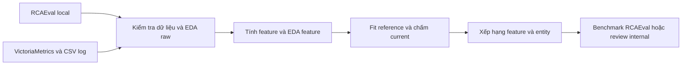

# RCA Benchmark Lab

Một project Python, hai luồng chạy local. Mở thư mục project bằng VS Code.

Code nằm trực tiếp trong `src/`; chạy module bằng `python -m src.cli` từ gốc project. Sau khi đổi cấu trúc, chạy lại `python -m pip install -e . --no-deps` để cập nhật lệnh `rca-lab`.

- RCAEval: mặc định `~/Downloads/rca_eval`; có thể đổi qua `RCA_DATA_ROOT`.
- Internal: metric query từ VictoriaMetrics; 5 CSV log tại `~/Downloads/anomaly`, có thể đổi qua `RCA_LOG_ROOT`.



## 1. Cài đặt

Ubuntu, Python 3.12, terminal tại thư mục project:

```bash
python3.12 -m venv .venv312
source .venv312/bin/activate
python -m pip config --user set global.index-url http://172.20.1.22:8081/repository/pypi-all/simple
python -m pip config --user set global.trusted-host 172.20.1.22
python -m pip install -r requirements.txt
python -m pip install -e . --no-deps
```

Hai lệnh `pip config` dùng mirror nội bộ đã cung cấp, thay đổi cấu hình pip của user. Không cần chạy nếu đã cấu hình đúng. Project không tự chuyển sang mirror ngoài. VS Code → **Python: Select Interpreter** → `.venv312/bin/python`.

Windows: tạo môi trường bằng `py -3.12 -m venv .venv312`, activate bằng `.venv312\Scripts\Activate.ps1`; chạy CLI Python thay cho script Bash. Nhấn F5 để chọn một trong hai flow và nhập thời gian/đường dẫn.

## 2. RCAEval trên dữ liệu đầy đủ

```bash
bash scripts/run_rcaeval_local.sh check "$HOME/Downloads/rca_eval"
bash scripts/run_rcaeval_local.sh full "$HOME/Downloads/rca_eval"
```

`full` kiểm tra từng ca trước khi benchmark 735 ca. Không tải mạng, không tự bỏ ca lỗi. Dùng `eda` thay `full` nếu chỉ khảo sát; `smoke` chạy hai ca để kiểm tra môi trường. Nguồn phải là corpus đã giải nén RE1-OB…RE3-TT hoặc bản Parquet được reader hỗ trợ.

Nếu preflight lỗi: mở `preflight.csv` tại thư mục output được in trên terminal. Chi tiết xử lý clock: [Phân tích và kết quả](docs/analysis.md).

## 3. Metric và log internal

Sửa `config/internal.json`:

1. Bật `metric.enabled` và/hoặc `log.enabled`.
2. Metric: thay năm `match_labels`, chọn `entity_label`; khai báo đúng tên, kind, unit và dimensions. Danh sách mặc định chỉ có request, response và process_time_ms; mở rộng theo [matching](docs/matching.md).
3. Log: kiểm tra năm tên CSV, system_id, timezone và service ID. Log không có Pod nên không tự ghép vào Pod metric.
4. Chọn khoảng reference tương đối ổn định trước khoảng cần kiểm tra. Mặc định cần ít nhất 20 cửa sổ reference.

```bash
export RCA_VM_API_URL='http://YOUR_HOST:PORT/select/TENANT/prometheus/api/v1'
export RCA_LOG_ROOT="$HOME/Downloads/anomaly"
read -rp 'START (UTC epoch giây): ' START
read -rp 'REFERENCE_END (UTC epoch giây): ' REFERENCE_END
read -rp 'END (UTC epoch giây): ' END
bash scripts/run_internal_local.sh "$START" "$REFERENCE_END" "$END" eda
bash scripts/run_internal_local.sh "$START" "$REFERENCE_END" "$END" full
```

URL là API tương ứng VMUI, kết thúc ở `/api/v1`; dùng đúng endpoint single-node hoặc cluster của hệ thống. Nếu cần, đặt `RCA_VM_AUTHORIZATION` qua môi trường. Không lưu token vào Git. Trace/alarm giữ tắt.

Mặc định query tối đa một giờ; chia khoảng chạy hoặc điều chỉnh `max_export_seconds`, `max_rows` theo tài nguyên. CSV và JSON raw chỉ được lưu local trong output.

## 4. Đọc kết quả

| Cần xem | File/thư mục trong output |
|---|---|
| Chất lượng và phân bố raw | `raw_eda/`, các file quality |
| Feature dùng phân tích | `features.parquet`, `coverage.csv` |
| Phân bố, tương phản, tương quan feature | `entity_*/feature_eda/` |
| Feature tương đương RCAEval | `calculated_features/` của internal |
| Feature gây chú ý, thời điểm và giá trị | `feature_ranking.csv`, `evidence.csv` |
| Thứ hạng entity | `ranking.csv` |
| Tham số fit và dữ liệu reference | `entity_*/model.json`, `reference.parquet` |
| Kết quả benchmark | `benchmark_*.csv`, `case_results.csv` của RCAEval |
| Kiểm tra run hoàn tất, checksum | `manifest.json` |

Mỗi run dùng output mới. Internal chưa có nhãn: kết quả là bằng chứng bất thường cần review, chưa xác nhận root cause. Điểm của các phương pháp không cùng thang đo.

## 5. Tài liệu và kiểm thử

- [Mục đích từng file](docs/files.md)
- [Matching metric/log với RCAEval](docs/matching.md)
- [EDA, threshold, model và bằng chứng](docs/analysis.md)
- [Quy ước project](docs/conventions.md)

```bash
python -m pip install -r requirements-dev.txt
python -m pytest -q
python scripts/package_repo.py
```

Lệnh cuối tạo ZIP triển khai theo danh sách file được chọn, không chứa dữ liệu, môi trường Python, tài liệu cũ hoặc demo. Không xóa file gốc. Không ghi đè ZIP đã tồn tại; dùng `--output` để chọn tên mới.
