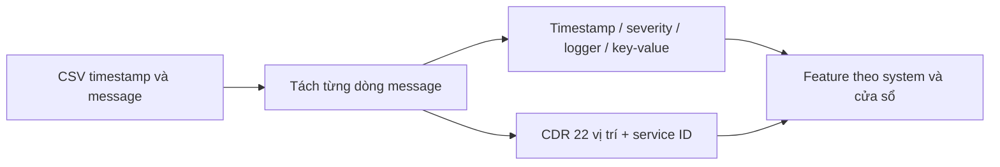

# Matching dữ liệu

Mục tiêu: giữ cùng ý nghĩa, đơn vị và cấp đối tượng khi so sánh. Cùng tên chưa đủ để kết luận tương đương.

## 1. Danh mục chi tiết

| Bảng | Nội dung |
|---|---|
| [internal_metrics.csv](matching/internal_metrics.csv) | 60 metric từ ảnh hệ thống |
| [rcaeval_metrics.csv](matching/rcaeval_metrics.csv) | 2.064 mục metric RCAEval và mức matching |
| [rcaeval_raw_metrics.csv](matching/rcaeval_raw_metrics.csv) | 8.053 mục raw metric RCAEval |
| [rcaeval_logs.csv](matching/rcaeval_logs.csv) | 41 mục đối chiếu log |
| [cdr_fields.csv](matching/cdr_fields.csv) | 110 vị trí trường của năm template CDR |

Các bảng là đối chiếu danh mục/schema đã cung cấp, không phải kết quả đo telemetry thật. Cột nguồn, trạng thái và điều kiện trong từng bảng là căn cứ review.

## 2. Metric → feature

| Nguồn internal | Tính toán | Ý nghĩa / điều kiện |
|---|---|---|
| container_cpu_usage_seconds_total | delta / delta thời gian | CPU cores, không phải phần trăm quota |
| container_memory_working_set_bytes, container_memory_rss | giữ gauge | RAM bytes; hai đại lượng khác nhau |
| working set / memory limit | tỷ lệ khi limit > 0 | Áp lực RAM container |
| container_fs_*_bytes_total | rate riêng từng series | Byte/s đọc, ghi; reset và thiếu phải kiểm tra |
| request_counter, response_counter | rate rồi so sánh cùng dimensions | Throughput và chênh lệch request/response |
| process_time_ms | gauge nếu exporter xác nhận | Latency ms; không tự lấy rate của gauge |
| node_memory_MemTotal_bytes, MemAvailable_bytes | 1 - available / total | Tỷ lệ RAM sử dụng node |
| node_filesystem_free_bytes, size_bytes | 1 - free / size | Tỷ lệ đầy theo device/mountpoint |
| node_disk_*_time_seconds_total / *_completed_total | tỷ lệ delta | Thời gian IO trung bình, không phải APP latency |
| Aerospike read/write/delete error và success | error / (error + success) | Tỷ lệ lỗi DB theo cùng phạm vi |
| Aerospike *_bucket | cần đủ bucket, le và rate | Histogram DB không thay APP latency percentile |

19 công thức nằm ở `config/feature_mapping.json`, thực thi bằng `features/metric_mapping.py`. Recipe thiếu nguồn/khác đơn vị không được bịa giá trị; xem audit trong `calculated_features/`. Feature tính toán được EDA riêng, chưa tự thêm vào model để tránh đếm trùng tín hiệu.

Không suy ra network throughput, CPU quota utilization, trace hoặc fault label nếu thiếu nguồn. APP, DB, CONTAINER, SERVER phải giữ đúng cấp đối tượng.

## 3. CSV message → log feature

Parser giữ `source_file`, số record/dòng để truy ngược. Đọc timestamp của dòng khi có; giữ cả timestamp CSV. ID giữ dạng chuỗi.

| Internal | Tương ứng RCAEval | Giới hạn |
|---|---|---|
| @timestamp / logger timestamp | thời điểm log | Cần xác nhận timezone |
| message | log content | Tách multiline trước khi đếm event |
| system_id từ cấu hình CSV | service/entity | Chỉ proxy; chưa phải Pod/service RCAEval |
| INFO/WARN/ERROR | severity | CustHis_Rollback ở INFO không tự thành lỗi |
| logger, topic, thread | ngữ cảnh/template | Không tương đương trace/span |
| CDR positional fields | trường nghiệp vụ riêng | Không có tương đương trực tiếp trong RCAEval |
| count, error ratio, parse rate, delay | log window features | So sánh hành vi, không chuyển thành fault label |

Parser có 21 feature event và 3 feature log cơ bản. Schema 22 vị trí chỉ là ứng viên theo template: phải đúng service ID, số trường và ngữ cảnh write trong cell. Không coi số tiền thô là đơn vị tiền đã xác nhận. `logger_time - createDate` là độ trễ log, không phải process_time của request.

## 4. Ghép metric với log

Chỉ ghép sau khi xác nhận system mapping, entity, timezone và cửa sổ thời gian. `instance` là endpoint exporter, không mặc định là service. `namespace` không chứa Node. Không ghép CDR hệ thống vào Pod chỉ vì timestamp gần nhau.

BA/owner cần chốt: request/response có quan hệ 1:1 không; retry/batch/asynchronous; mã thành công; đơn vị process_time; khóa giao dịch; event ghi nhận hoàn tất; SLA và mapping service → VDU/Pod. Khi chưa chốt, giữ trạng thái cần review.
